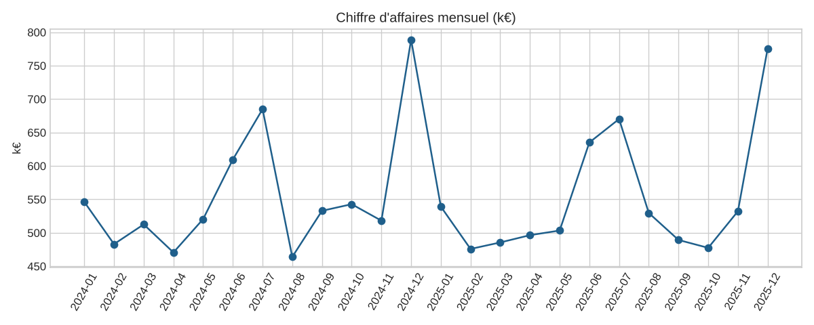
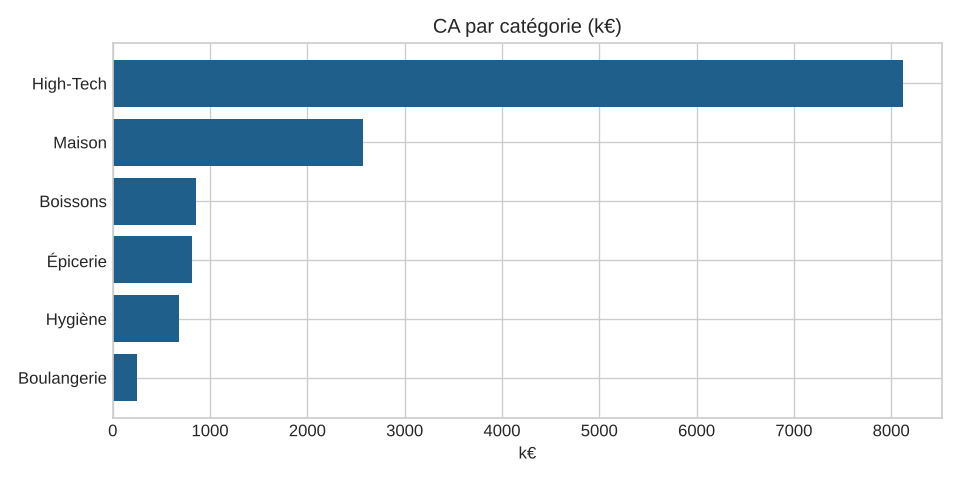
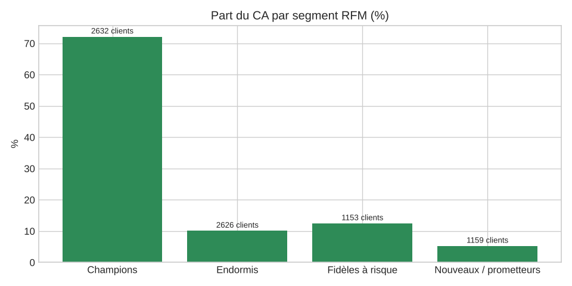

# 🛒 Retail Sales Analytics — SQL · Python · Power BI

Analyse complète des ventes d'une enseigne de distribution (17 magasins dans 6 régions, 300 produits, 8 000 clients,
50 000 commandes et 150 000 lignes de vente sur 2024-2025) : du fichier brut jusqu'au tableau de bord décisionnel.



## 🎯 Questions métier traitées

- Quelle est l'évolution du chiffre d'affaires et de la marge, et quelle est la croissance N vs N-1 ?
- Quelles catégories et quels magasins performent le mieux (CA, CA/m², marge) ?
- Quel est le poids de chaque canal (magasin, web, click & collect) ?
- Qui sont nos meilleurs clients et lesquels risquent de partir ? (segmentation **RFM**)

## 🧱 Architecture

```
CSV bruts ──► Nettoyage (Pandas) ──► Modèle en étoile (SQLite) ──► KPI SQL ──► Graphiques + Power BI
              qualité des données      fact_sales + 4 dimensions    CTE, fenêtres   segmentation RFM
```

| Étape | Détail |
|---|---|
| Qualité | Suppression des quantités négatives, prix manquants, doublons (≈0,5 % des lignes) |
| Modélisation | Schéma en étoile : `fact_sales`, `dim_date`, `dim_product`, `dim_store`, `dim_customer` |
| SQL | Agrégations, CTE, jointures, `RANK() OVER`, croissance YoY ([sql/kpi_queries.sql](sql/kpi_queries.sql)) |
| Analyse | Segmentation RFM en 4 segments (Champions, Fidèles à risque, Nouveaux / prometteurs, Endormis) |
| BI | 12 mesures DAX prêtes à l'emploi ([powerbi/dax_measures.md](powerbi/dax_measures.md)) |

## 🚀 Lancer le projet

```bash
pip install -r requirements.txt
python data/generate_data.py      # génère les CSV dans data/raw/
python src/pipeline.py            # nettoie, construit retail.db, calcule les KPI, exporte les figures
pytest                            # tests unitaires
```

## 📊 Résultats

| CA par catégorie | Segments RFM |
|---|---|
|  |  |

**Enseignements clés** (sur les données générées) :
- Forte saisonnalité : pic en décembre et en été, le samedi est le jour le plus fort.
- Le High-Tech porte une grande part du CA malgré un volume faible ; l'Épicerie porte les volumes.
- CA de 13,3 M€, taux de marge de 31,9 %, panier moyen de 266 €.
- Les « Champions » (≈35 % des clients) génèrent ≈70 % du CA → cible prioritaire d'un programme de fidélité ;
  les « Fidèles à risque » (12 % du CA) sont à réactiver en priorité.

## 🛠️ Stack

Python (Pandas, NumPy, Matplotlib) · SQL (SQLite) · Power BI (DAX) · Pytest

## 📁 Structure

```
├── data/generate_data.py    # générateur de données synthétiques
├── src/pipeline.py          # pipeline d'analyse de bout en bout
├── sql/kpi_queries.sql      # requêtes KPI
├── powerbi/dax_measures.md  # modèle et mesures DAX
├── reports/figures/         # graphiques générés
└── tests/
```

---
👤 **Espérance DAYE** — Data Analyst / Data Engineer · [LinkedIn](https://linkedin.com/in/Esperance-DAYE)
